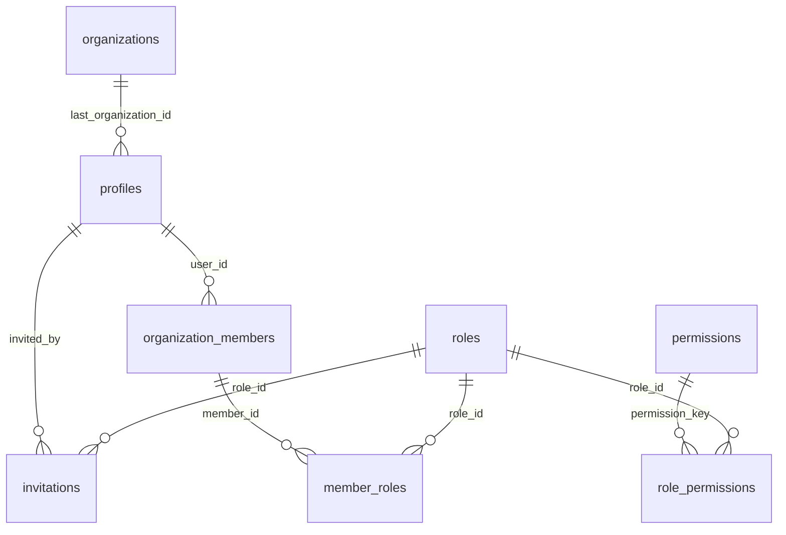
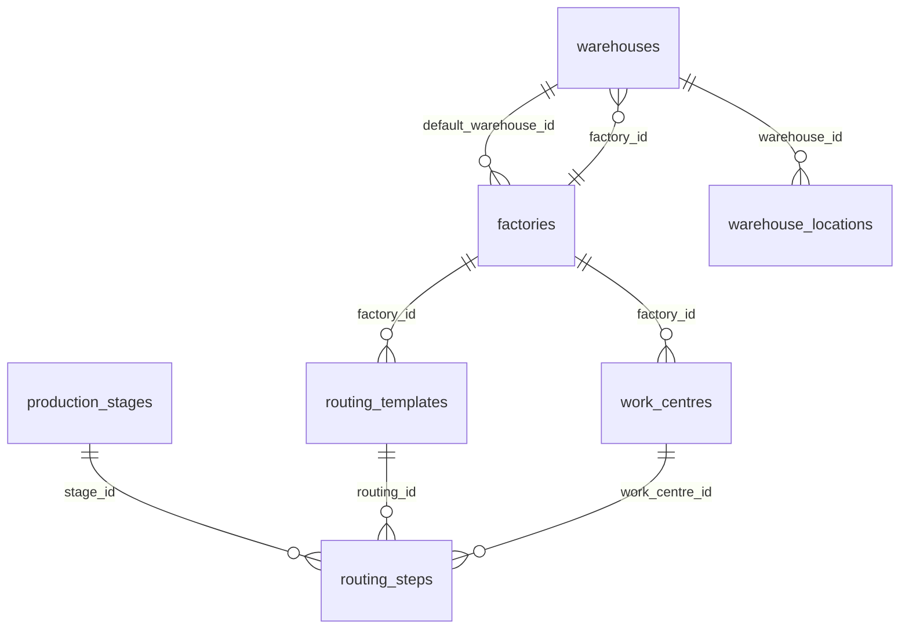
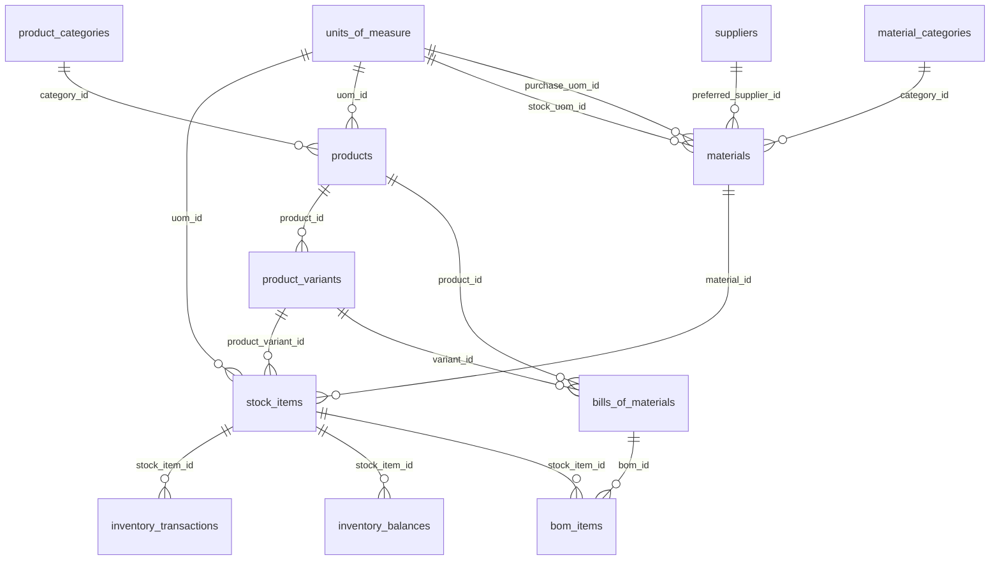
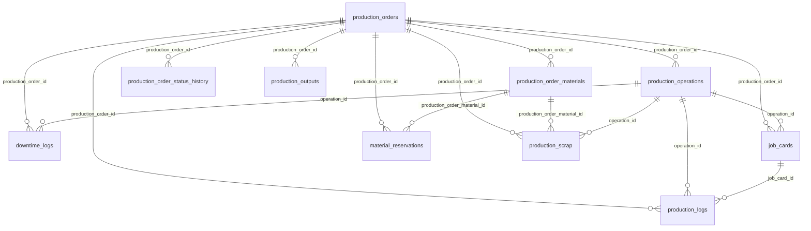

# Entity relationship diagram

Generated from foreign keys by `scripts/gen-schema-docs.mjs`. Links to `organizations` (present on every tenant table) are omitted for readability.

## Identity & RBAC

## Factory

## Catalogue & inventory

## Production

